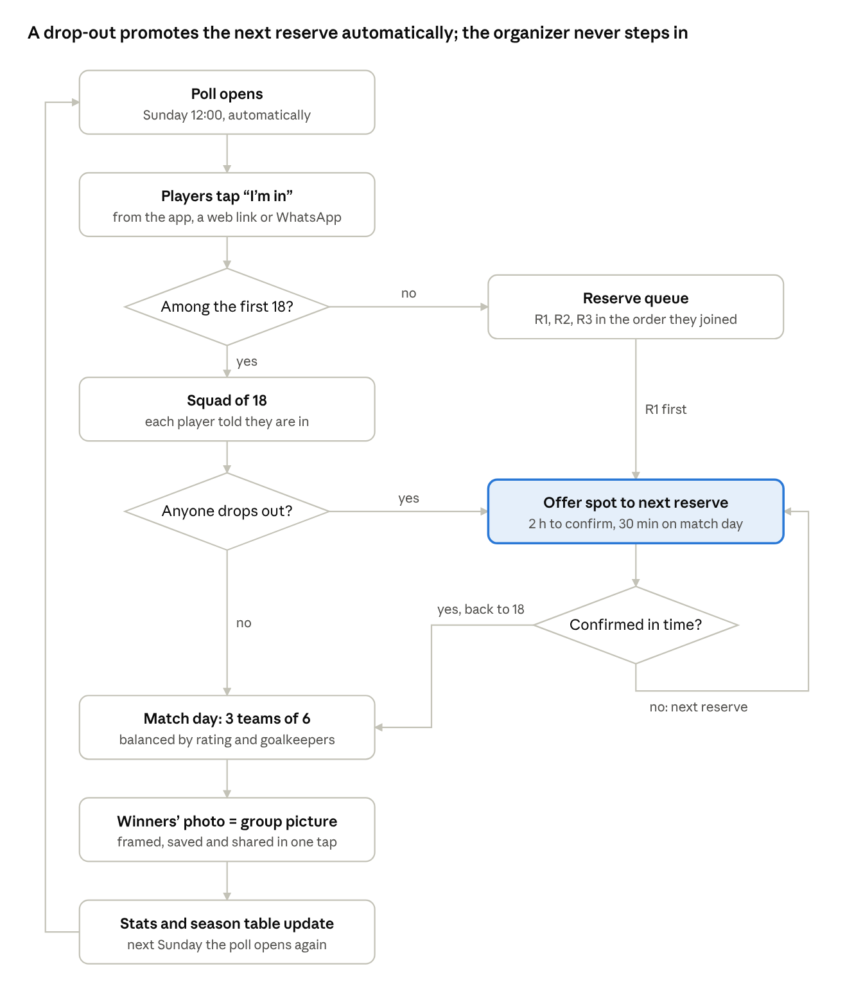
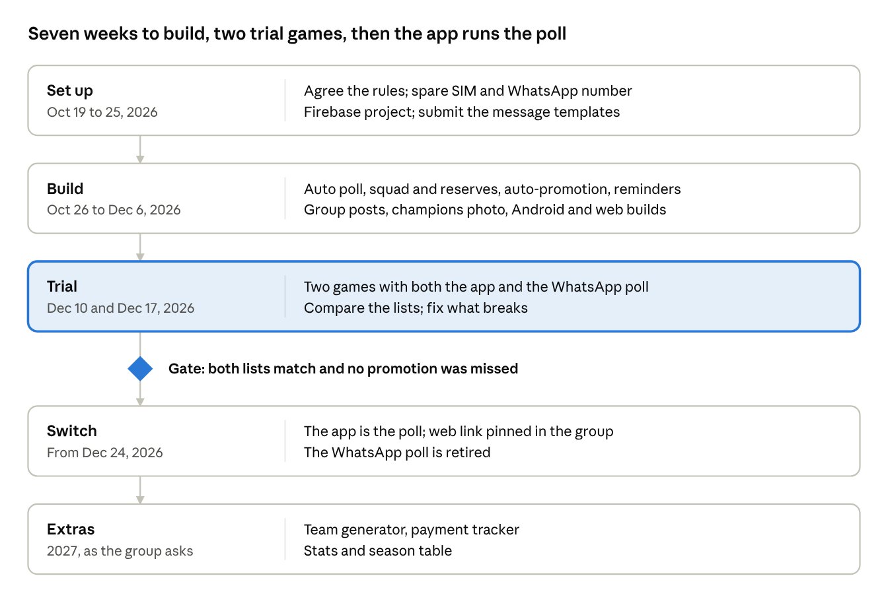
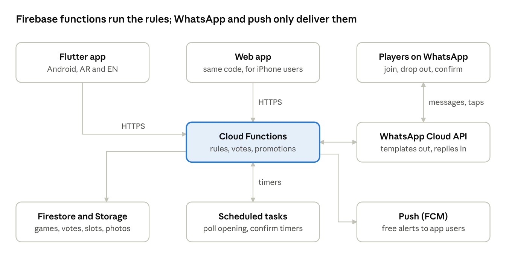

# Tashkeela — Our Weekly Football App Plan

October 15, 2026

> Editable, commentable version: https://claude.ai/code/artifact/74db5c81-5d49-409d-a930-97f83e6e5efd
> Mobile design (10 screens): https://claude.ai/artifact/TYJxHpCGb4gPDLDym5r6sE

## Executive summary

Tashkeela (Arabic for "line-up"; working name) is a Flutter app for our own Thursday game, not a business. It opens the poll on time, locks the first 18 players in, queues everyone else as reserves, and promotes the next reserve the moment someone drops out. WhatsApp stays where the group talks: the app sends personal reminders there and hands the organizer ready-made posts for the group.

- **Who it serves:** our organizer and the 24 members of the group. The format is 18 players: 3 teams of 6, winner stays on.
- **The promise:** the poll opens itself, the first 18 are in, reserves move up automatically, and nobody chases anybody.
- **Scope:** Greater Cairo 5-a-side groups: ours first; friends' groups can be added later if they want it.
- **Running cost:** about 62 EGP a month for WhatsApp messages, under 3 EGP per member. No funding, subscriptions or ads.
- **Plan:** about 7 weeks of evening work, two weeks running beside the WhatsApp poll, then the app takes over from the 24 December game.

All EGP figures assume 1 USD = 50 EGP.

## The problem

The weekly poll fills 18 slots in minutes, but everything after the poll runs on one organizer's memory and patience. Each step below is manual today.

| Moment | What happens today | What it costs |
| --- | --- | --- |
| Poll opens | The organizer must post it at the exact agreed minute, or people complain it was unfair. | The organizer is on call every week. |
| Who's in | Someone counts the first 18 voters by hand and pastes a list. Votes can be removed and re-cast. | Disputes over order; a list that is wrong by Thursday. |
| A player drops out | The organizer messages reserve #1, waits, then #2, often on match day. | Games start with 16 or 17 players and uneven teams. |
| Teams | Picked at the pitch, usually by the same two people. | Lopsided games and arguments. |
| Paying the pitch | The organizer pays the venue, then chases 17 transfers. | Money lost and awkward reminders. |
| After the match | The winners' photo becomes the group picture; the result is lost in the chat. | No history, no stats, no record of who shows up. |

The group chat also carries 100+ messages per game, so players mute it and miss the one message that matters: "you're in, reserve #1 got promoted".

## The solution and core features

The organizer sets the game up once; after that the app runs the weekly cycle and the organizer just plays. Only the organizer must install the app: players can join from the app, a web link, or a button in a WhatsApp message.

The promotion loop (highlighted) is the organizer's biggest weekly chore today; the app runs it without them.

| Feature | What it does | When |
| --- | --- | --- |
| Recurring game | Day, time, venue, capacity (18), format (3 teams of 6), poll opening time, drop-out deadline. | First version |
| Auto poll | Opens at the exact minute. Order is set by server timestamp, so "who voted first" is never disputed. | First version |
| Squad and reserve queue | First 18 are in; everyone after is a numbered reserve. Live list for all. | First version |
| Auto-promotion | A drop-out promotes reserve #1, who gets a confirm window (2 hours; 30 minutes on match day). No reply moves the slot to the next reserve. | First version |
| Reminders | Poll opening, "you're in", "you've been promoted", match day, payment due. | First version |
| Group posts | Ready-made Arabic or English posts (squad list, changes, result) shared to the group in one tap. | First version |
| Champions photo | Upload the winners' photo; the app crops it to a group icon with a "Champions, week 12" frame, ready to set as the group picture. | First version |
| Team generator | Balances 3 teams by rating, position and goalkeepers; bib colours. | Later |
| Payment tracker | Splits the pitch fee, shows who paid, and sends InstaPay or wallet reminders. | Later |
| Stats and season table | Attendance, wins, MVP votes, late drop-outs; a season leaderboard. | Later |
| Priority rules | Optional: regulars get a head start, late drop-outs start next week as reserves. | Later |

Fairness is the product. Every rule (who gets in, who moves up, how long a reserve has to confirm) is visible to all players and logged.

## WhatsApp integration strategy

Send personal messages through the official WhatsApp Business Platform, and let the organizer post to the group in one tap. Do not automate the group itself: the official Groups API cannot hold an 18-player group, and unofficial bots get numbers banned.

| Job | How the app does it | Within WhatsApp's rules | Cost |
| --- | --- | --- | --- |
| Personal reminders: poll open, you're in, promoted, match day, pay | Cloud API utility templates in Arabic and English, sent from the group's own WhatsApp Business number (a spare SIM) | Yes | About $0.0036 per message in Egypt |
| Join or decline without the app | Quick-reply buttons ("I'm in" / "Not this week") on the poll message; the webhook records the vote | Yes | Replies are free |
| Posts in the existing group | The app writes the post and link; the organizer taps Share and picks the group | Yes (standard share) | Free |
| Champions photo as group picture | The app crops and frames the photo, saves it, and opens the group; the organizer sets it in two taps | Yes | Free |
| App-created groups (Groups API) | Not used: groups cap at 8 members, join by invite link only, Official Business Account required | n/a | n/a |
| Unofficial bots (whatsapp-web.js, Baileys) | Not used: against WhatsApp's terms; a ban would silence every group at once | No | n/a |

**Cost for our group.** 24 members get about 70 business messages a week. That is roughly $1.10 (55 EGP) a month, or 62 EGP with 14% VAT. Players who install the app can turn WhatsApp reminders off and get free push notifications instead.

**Fairness on WhatsApp.** Template delivery can lag by seconds, so the WhatsApp message announces the poll; the server clock decides the order. The opening time is fixed and shown a week ahead, so nobody depends on a notification to be first.

**Compliance.** Players opt in to WhatsApp messages when they join. Templates stay transactional (no marketing), which keeps cost low and the number's quality rating high.

Rates and Groups API limits come from third-party summaries ([Egypt rate card](https://chatmaxima.com/whatsapp-api-pricing/egypt/), [rates by country](https://www.flowcall.co/blog/whatsapp-business-api-pricing), [Groups API limits](https://periskope.app/blog/whatsapp-groups-api-requirements-eligibility-limits)). Confirm both on Meta's developer pages before launch.

## Who uses it

Three roles, and only the organizer has to install anything.

| Role | Who | What they do |
| --- | --- | --- |
| Organizer | You, plus one co-admin as backup | Set up the game and rules, fix the list by hand if needed, share posts and the champions photo |
| Players | The group's 24 members | Join, drop out and confirm from the app, the web link or WhatsApp buttons |
| Other groups (optional) | Friends' weekly games | Added later as separate groups in the same app; the only extra cost is their WhatsApp messages |

## Build, or use an existing app?

Build it: the apps we know of don't run a first-come squad, a reserve queue and WhatsApp reminders together, and the first version is small.

| Option | Good at | Why it falls short for us |
| --- | --- | --- |
| Keep the WhatsApp poll | Free; everyone is already there | No fixed opening, no reserve queue, no auto-promotion, no history |
| Spond, TeamSnap, Heja | Attendance and payments for clubs with fixed rosters | Built for invited rosters, not first-come squads; every player must install the app |
| Pitch-booking apps | Finding and paying for a slot | They book the venue; they don't run the group |

## Running costs

The app costs about 62 EGP a month, all of it WhatsApp messages; everything else fits in free tiers. Add 3 EGP a month to each player's pitch share, or pay it from the group fund.

| Item | One-time (EGP) | Monthly (EGP) | Notes |
| --- | --- | --- | --- |
| WhatsApp Cloud API messages | 0 | about 62 | About 70 messages a week to 24 members, incl. 14% VAT |
| Firebase: database, functions, push, photos, web hosting | 0 | 0 | Stays inside the free quota at our size; the pay-as-you-go plan needs a card on file |
| Android install through Firebase App Distribution | 0 | 0 | Players get an install link and update alerts |
| iPhone: the web app, added to the home screen | 0 | 0 | Same Flutter code built for the web; push works on iOS 16.4 and later |
| Spare SIM for the WhatsApp number | A prepaid line | A small top-up | The number must not already be on WhatsApp |
| Optional: Apple Developer account | 0 | about 413 (4,950 a year) | Only for a native iPhone app through TestFlight |
| Optional: Google Play developer account | about 1,250 | 0 | Only for Play Store installs |

Skip both optional accounts at the start. The Apple account alone would make the app about eight times more expensive for the same features.

## Rolling it out to the group

Run the app beside the WhatsApp poll for two weeks, and switch only when both lists match.

1. **Agree the rules at a Thursday game.** Poll opening time, squad size, confirm windows, and what counts as a late drop-out.
2. **Set up the group.** The organizer adds the 24 members (name and number). Each gets a WhatsApp opt-in message with the web link.
3. **Two-week trial.** Post the WhatsApp poll as usual and open the app's poll at the same minute. Compare the two lists after each round.
4. **Switch.** From the 24 December game the app is the poll. Pin the web link in the group description.
5. **Pick the next feature.** After a month, ask the group what comes next: teams, payments or stats.

## Product roadmap

The first version covers only what the weekly game needs. Extras wait until the group asks for them.

## Technology and architecture

One Flutter codebase builds the Android app and the web app, on Firebase, so there is no server to run or pay for.

Every rule (order, promotion, timers) lives in Cloud Functions; WhatsApp, push and the web app only deliver it.

**What has to be right**

- **Fair ordering.** Each "I'm in" goes through one function that stamps it with server time. The first 18 by that time are the squad. A player holds one vote at most, so double taps count once.
- **Exact opening.** A scheduled function opens the poll at the set minute. The app's button follows the poll's state on the server, not the phone's clock.
- **Promotion engine.** Each open slot moves offered, then confirmed or expired, then on to the next reserve. Timers are scheduled tasks, so nothing depends on a phone being online.
- **WhatsApp.** Templates approved in Arabic and English, a webhook function for button replies, and an opt-in record per player.
- **Champions photo.** Cropped and framed on the phone (640 x 640 px), saved to the gallery and shared with the share sheet.
- **Privacy.** Store only names, phone numbers and game data; follow Egypt's Personal Data Protection Law (Law 151 of 2020). Players can leave and delete their data in the app.

iPhone players use the web app: same code, added to the home screen. A native iPhone build can come later without rewriting anything.

## Who builds and runs it

You build it in about 7 weeks of evenings, an estimated 60 to 80 hours, and a co-admin covers when you can't.

| Job | Who | Time |
| --- | --- | --- |
| Build the app (Flutter and Firebase) | You | About 60 to 80 hours over 7 weeks |
| WhatsApp number and templates | You, once | About 2 hours, then waiting for template approval |
| Design | The mockups, as they are | None |
| Run the weekly game | You, as organizer | A few minutes a week after the switch |
| Cover when you're away | One trusted player as co-admin | Fix the list or reopen a poll if something breaks |

**Operations**

- Watch the first poll openings live, with the WhatsApp poll as a fallback.
- No app updates in the 24 hours before a poll opens or a game starts.
- Keep the code in this repository so someone else can take over.

## How we'll know it works

The test is simple: every game kicks off with 18, and the organizer stops chasing people.

| Measure | Target after the switch |
| --- | --- |
| Games that kick off with all 18 players | Every game |
| Drop-outs refilled with no organizer action | Every drop-out |
| Organizer time per week | Under 5 minutes |
| Members who can vote (app, web link or WhatsApp buttons) | All 24 |
| Arguments about who voted first | None |

## Risks and fallbacks

None of these can hurt the group much, because the WhatsApp poll stays available as a fallback. Most likely first.

| Risk | Fallback |
| --- | --- |
| Some players won't install the app | Nobody has to: WhatsApp buttons and the web link cover everyone |
| The WhatsApp number or templates take weeks to approve | Start with push notifications and one-tap group posts; add personal WhatsApp messages once approved |
| A bug at poll opening | The two-week trial beside the WhatsApp poll, a log of every vote, and a co-admin who can fix the list by hand |
| iPhone players want a real app | Web app first; buy the Apple account (4,950 EGP a year) only if the group agrees to share the cost |
| Android tightens installs from outside the Play Store | Google plans developer verification for such apps, country by country from 2026; if it reaches Egypt, verify or pay the one-time Play fee |
| Only one person can maintain it | A simple Firebase stack, the code in this repository, and a co-admin who knows the rules |
| Members' phone numbers | Store only names and numbers, never share them, and delete a member's data when they leave |

## Next steps

The app runs our game from Dec 24, 2026, after a two-week trial.

- [ ] Agree the rules with the group: poll time, confirm windows, late drop-out rule. Oct 22, 2026
- [ ] Get a spare SIM, open a Meta Business account and WhatsApp number, and submit the first 6 templates (Arabic and English). By Oct 25, 2026
- [ ] Create the Firebase project and the Flutter app skeleton. By Oct 25, 2026
- [ ] First version working on Android and the web. By Dec 6, 2026
- [ ] Trial games beside the WhatsApp poll. Dec 10, 2026 and Dec 17, 2026
- [ ] Switch: the first game run only by the app. Dec 24, 2026
