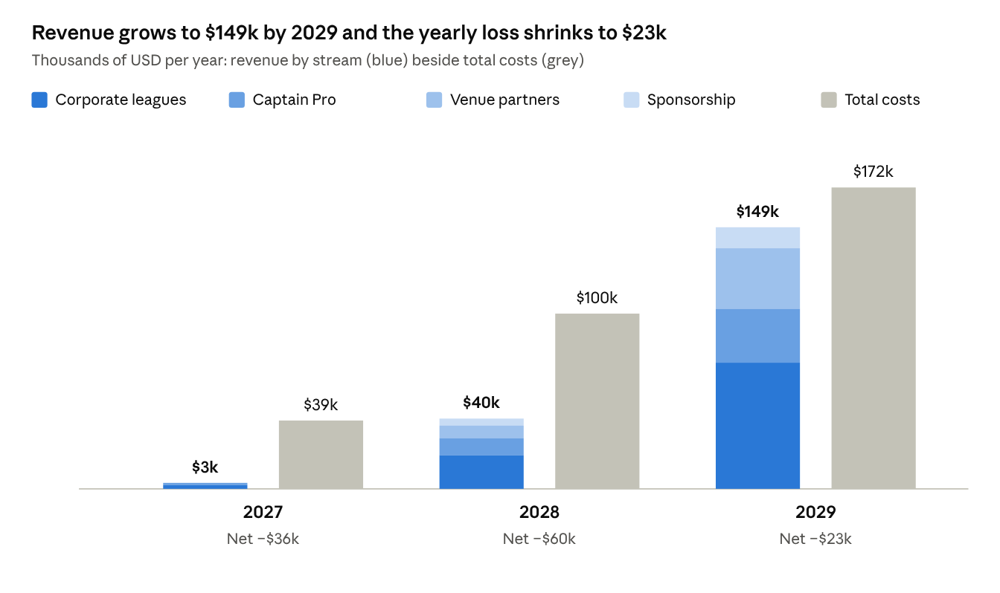

# Tashkeela — Weekly Football App Business Plan

October 15, 2026

> Editable, commentable version: https://claude.ai/code/artifact/74db5c81-5d49-409d-a930-97f83e6e5efd
> Mobile design (10 screens): https://claude.ai/artifact/TYJxHpCGb4gPDLDym5r6sE

## Executive summary

Tashkeela (Arabic for "line-up"; working name) turns the weekly WhatsApp football poll into a Flutter app. It opens the poll on time, locks the first 18 players in, queues everyone else as reserves, and promotes the next reserve the moment someone drops out. WhatsApp stays the place where the group talks: the app sends personal reminders there and hands the organizer ready-made posts for the group.

- **Who it serves:** the organizer ("captain") of a recurring weekly game and the 17+ players around them. The launch format is the common 18-player night: 3 teams of 6, winner stays on.
- **The promise:** the poll opens itself, the first 18 are in, reserves move up automatically, and nobody chases anybody.
- **Launch market:** Greater Cairo 5-a-side groups, then Alexandria, then Saudi Arabia and the UAE, where WhatsApp is equally central.
- **Revenue:** a Captain Pro subscription per group (149 EGP a month, about 1.9 EGP per player per week), corporate leagues paid from HR wellness budgets, and pitch partnerships.
- **Plan:** a 10-week MVP, a pilot with 10 groups, and 1,000 weekly active groups within 12 months of launch.
- **Funding:** bootstrap the MVP and pilot for about $10,000 (one contract Flutter engineer and a part-time designer, with the founder on the backend), then raise a $150,000 pre-seed once the pilot proves retention.

All EGP figures assume 1 USD = 50 EGP.

## The problem

The weekly poll fills 18 slots in minutes, but everything after the poll runs on one organizer's memory and patience. Each step below is manual today.

| Moment | What happens today | What it costs |
| --- | --- | --- |
| Poll opens | The organizer must post it at the exact agreed minute, or people complain it was unfair. | The organizer is on call every week. |
| Who's in | Someone counts the first 18 voters by hand and pastes a list. Votes can be removed and re-cast. | Disputes over order; a list that is wrong by Thursday. |
| A player drops out | The organizer messages reserve #1, waits, then #2, often on match day. | Games start with 16 or 17 players and uneven teams. |
| Teams | Picked at the pitch, usually by the same two people. | Lopsided games and arguments. |
| Paying the pitch | The organizer pays the venue, then chases 17 transfers. | Money lost and awkward reminders. |
| After the match | The winners' photo becomes the group picture; the result is lost in the chat. | No history, no stats, no record of who shows up. |

The group chat also carries 100+ messages per game, so players mute it and miss the one message that matters: "you're in, reserve #1 got promoted".

## The solution and core features

The organizer sets the game up once; after that the app runs the weekly cycle and the organizer just plays. Only the organizer must install the app: players can join from the app, a web link, or a button in a WhatsApp message.

The promotion loop (highlighted) is the organizer's biggest weekly chore today; the app runs it without them.

| Feature | What it does | Phase |
| --- | --- | --- |
| Recurring game | Day, time, venue, capacity (18), format (3 teams of 6), poll opening time, drop-out deadline. | MVP |
| Auto poll | Opens at the exact minute. Order is set by server timestamp, so "who voted first" is never disputed. | MVP |
| Squad and reserve queue | First 18 are in; everyone after is a numbered reserve. Live list for all. | MVP |
| Auto-promotion | A drop-out promotes reserve #1, who gets a confirm window (2 hours; 30 minutes on match day). No reply moves the slot to the next reserve. | MVP |
| Reminders | Poll opening, "you're in", "you've been promoted", match day, payment due. | MVP |
| Group posts | Ready-made Arabic or English posts (squad list, changes, result) shared to the group in one tap. | MVP |
| Champions photo | Upload the winners' photo; the app crops it to a group icon with a "Champions, week 12" frame, ready to set as the group picture. | MVP |
| Team generator | Balances 3 teams by rating, position and goalkeepers; bib colours. | V1 |
| Payment tracker | Splits the pitch fee, shows who paid, and sends InstaPay or wallet reminders. | V1 |
| Stats and reliability | Attendance, wins, MVP votes, late drop-outs; a season leaderboard. | V1 |
| Priority rules | Optional: regulars get a head start, late drop-outs start next week as reserves. | V1 |
| Pitch booking | Book and pay recurring slots with partner venues. | V2 |

Fairness is the product. Every rule (who gets in, who moves up, how long a reserve has to confirm) is visible to all players and logged.

## WhatsApp integration strategy

Send personal messages through the official WhatsApp Business Platform, and let the organizer post to the group in one tap. Do not automate the group itself: the official Groups API cannot hold an 18-player group, and unofficial bots get numbers banned.

| Job | How the app does it | Within WhatsApp's rules | Cost |
| --- | --- | --- | --- |
| Personal reminders: poll open, you're in, promoted, match day, pay | Cloud API utility templates in Arabic and English, sent from one verified Tashkeela number | Yes | About $0.0036 per message in Egypt |
| Join or decline without the app | Quick-reply buttons ("I'm in" / "Not this week") on the poll message; the webhook records the vote | Yes | Replies are free |
| Posts in the existing group | The app writes the post and link; the organizer taps Share and picks the group | Yes (standard share) | Free |
| Champions photo as group picture | The app crops and frames the photo, saves it, and opens the group; the organizer sets it in two taps | Yes | Free |
| App-created groups (Groups API) | Not used: groups cap at 8 members, join by invite link only, Official Business Account required | n/a | n/a |
| Unofficial bots (whatsapp-web.js, Baileys) | Not used: against WhatsApp's terms; a ban would silence every group at once | No | n/a |

**Cost per group.** A 24-member group gets about 70 business messages a week if everyone uses WhatsApp. That is roughly $1.10 (55 EGP) a month before 14% VAT. App users get free push notifications instead. On the Free plan, WhatsApp carries only the poll opening and promotions, and only to players without the app; Captain Pro unlocks the full set.

**Fairness on WhatsApp.** Template delivery can lag by seconds, so the WhatsApp message announces the poll; the server clock decides the order. The opening time is fixed and shown a week ahead, so nobody depends on a notification to be first.

**Compliance.** Players opt in to WhatsApp messages when they join. Templates stay transactional (no marketing), which keeps cost low and the number's quality rating high.

Rates and Groups API limits come from third-party summaries ([Egypt rate card](https://chatmaxima.com/whatsapp-api-pricing/egypt/), [rates by country](https://www.flowcall.co/blog/whatsapp-business-api-pricing), [Groups API limits](https://periskope.app/blog/whatsapp-groups-api-requirements-eligibility-limits)). Confirm both on Meta's developer pages before launch.

## Target market and sizing

Greater Cairo and Alexandria hold an estimated 37,500 recurring weekly games; the plan targets 4,500 of them by the end of year 3, plus 1,500 in the Gulf. Every input below is an assumption to test with pitch owners in the first month.

**Segments, in launch order**

1. **Weekly friend groups (core).** 18 to 24 members, one organizer, a WhatsApp poll. They pay for Captain Pro.
2. **Company teams and corporate leagues.** HR teams fund a weekly game or an inter-department league from wellness budgets. They pay a monthly league fee.
3. **Pitch owners.** They want the same groups back every week. They are a distribution channel first and a paying partner from year 2.
4. **Gulf expats and locals (year 3).** Riyadh, Jeddah and Dubai run the same WhatsApp-poll ritual at higher prices.

**Bottom-up sizing (Egypt)**

| Layer | Assumption | Weekly groups | Players |
| --- | --- | --- | --- |
| All recurring games | 1,500 rentable pitches x 25 recurring weekly bookings | 37,500 | about 750,000 (20 per group) |
| Serviceable | 60% run on a WhatsApp poll with one organizer | 22,500 | about 450,000 |
| Year-3 target | 20% of serviceable groups active weekly | 4,500 | about 90,000 |

The pitch count is the weakest input. Visit 20 venues in month 1 to count pitches, recurring bookings and evening occupancy.

## Competition and differentiation

The real competitor is the free WhatsApp poll; Tashkeela wins only if it is easier than the poll for the organizer and no harder for players.

| Alternative | Good at | Gap for the weekly 18-player game |
| --- | --- | --- |
| WhatsApp poll + manual list | Free; everyone is already there | No fixed opening, no reserve queue, no auto-promotion, no history |
| Spond, TeamSnap, Heja | Attendance and payments for clubs with fixed rosters | Built for invited rosters, not first-come squads; English-first; players must install the app |
| Pitch-booking apps (Playtomic for padel, local football booking apps) | Finding and paying for a slot | They book the venue; they don't run the group |
| Pickup-game apps (Footy Addicts style) | Filling games with strangers | Different job: groups of friends don't want strangers |

**Where Tashkeela is different**

- **WhatsApp-native.** Players can join, drop out and confirm from WhatsApp buttons; only the organizer needs the app.
- **Built for the first-come ritual.** Exact-minute opening, a visible reserve queue and automatic promotion with confirm windows.
- **Local by default.** Arabic and English, EGP prices, InstaPay and wallet reminders, Thursday-night defaults.
- **The rituals.** The champions photo, weekly records and a season table give the group a reason to stay.

## Business model and pricing

The core game stays free forever; money comes from organizers who want less work, companies that run leagues, and venues that want full pitches.

| Plan | Who pays | Price | What it adds |
| --- | --- | --- | --- |
| Free | Nobody | 0 | One recurring game, auto poll, squad and reserves, auto-promotion, push alerts, WhatsApp for poll opening and promotions, group posts, champions photo |
| Captain Pro | The organizer, split into the pitch fee | 149 EGP a month or 1,490 EGP a year per group; Gulf: 19 SAR or 19 AED a month | Full WhatsApp reminders, team generator, payment tracker, stats and season table, priority rules, co-organizers, several games |
| Corporate League | Company HR | From 4,000 EGP a month | Up to 4 groups, inter-department league table, branded champions frames, monthly attendance report |
| Venue Partner (year 2) | Pitch owner | 1,000 EGP a month, or a commission per booking | Recurring-slot booking, venue listing, QR code at the pitch, fewer no-shows |
| Sponsorship (year 2) | Sports and drinks brands | Per campaign | Sponsored champions frame, season awards |

**Why 149 EGP works.** Split across 18 players it is 1.9 EGP each per week. The app adds it to each player's pitch share, so the organizer never pays out of pocket.

**Unit economics of one Pro group (per month)**

| Line | EGP |
| --- | --- |
| Price | 149 |
| App store fee (15%) | -22 |
| WhatsApp messages (about half the players on WhatsApp, incl. VAT) | -31 |
| Hosting and storage | -5 |
| Contribution | 91 (61%) |

Payment processing waits until year 2. InstaPay transfers are free and already universal, so a fee on player payments would be rejected; the tracker reminds and records instead.

## Go-to-market

Grow organizer by organizer: each group that runs on Tashkeela shows 20+ players the product every week, and many of them play in a second group with its own organizer.

1. **Pilot (months 1 to 3).** Your own group plus 9 friend and colleague groups. Gate to scale: 8 of 10 groups still active after 8 weeks, and 90% of drop-outs refilled without the organizer.
2. **Player-to-organizer loop.** Every WhatsApp message and group post carries the join link. An organizer who brings another group gets one month of Pro free. Target: each active group brings 0.3 new groups a quarter.
3. **Pitch partners.** QR posters and a free recurring-bookings view for 20 venues in New Cairo, Nasr City, Maadi, Sheikh Zayed and 6th of October. Venue staff recommend the app to organizers at the desk.
4. **Corporate leagues.** Start with Cairo tech companies, your own employer included, with a free first season. HR gets an attendance report; employees get a league table.
5. **Ramadan leagues.** Night tournaments during Ramadan are a tradition. Pilot groups play a small Ramadan league in February 2027; from 2028, a branded city-wide Ramadan league recruits organizers at the busiest time of year.
6. **Champions content.** Groups opt in to share their champions photo on a public Tashkeela page; every post tags the group and links to the app.

Target organizer acquisition cost: under 100 EGP, mostly referral months and venue posters.

## Product roadmap

The MVP ships in 10 weeks, and nothing scales until the pilot gate is met. Features outside the MVP box wait for what pilot organizers actually ask for.

## Technology and architecture

One Flutter codebase for iOS and Android, on a TypeScript, Prisma and PostgreSQL backend: the stack your team already runs, with a small job queue for everything time-based.

Every rule (order, promotion, timers) lives in the API; WhatsApp, push and the web page are delivery channels that can be swapped without touching the rules.

**What has to be right**

- **Fair ordering.** Each "I'm in" is one database insert stamped with server time and a sequence number. The first 18 rows are the squad. Idempotency keys stop double taps from counting twice.
- **Exact opening.** A scheduled job opens the poll at the set minute. The app's button follows server state, not the phone's clock.
- **Promotion engine.** Each open slot moves offered, then confirmed or expired, then on to the next reserve. Confirm-window timers live in the job queue, so a restart loses none.
- **WhatsApp.** Templates approved in Arabic and English, a webhook for button replies, an opt-in record per player, and quality-rating alerts.
- **Champions photo.** Cropped and framed on the phone (640 x 640 px), saved to the gallery and shared with the platform share sheet.
- **Privacy.** Store only names, phone numbers and game data; follow Egypt's Personal Data Protection Law (Law 151 of 2020). Players can leave and delete their data in-app.

The web join page reuses Next.js, so players without the app can join, drop out or confirm from a link.

## Team and operations

Year 1 needs three people and a part-time designer; the team grows only after the pilot gate is passed.

| Role | Starts | Monthly cost (USD) |
| --- | --- | --- |
| Founder: product, first groups, partnerships | Now | 0 in year 1; 1,500 from year 2 |
| Flutter engineer | Month 1 | 1,200 on contract; 1,500 from year 2 |
| Backend engineer (the founder builds the MVP backend) | April 2027, after the pre-seed | 1,200 on contract; 1,500 from year 2 |
| Product designer, part-time | Months 1 to 6 | 500 |
| Growth and partnerships lead | Year 2 | 1,000 |
| Gulf business developer, Riyadh | Year 3 | 2,500 |
| Community and support, part-time | Year 3 | 600 |

**Operations**

- **Peak moments.** Poll openings (often a single minute for hundreds of groups) and Thursday and Friday nights. No releases in the 24 hours before either.
- **Support.** In-app chat and the Tashkeela WhatsApp number, answered within 2 hours on game days.
- **Releases.** Weekly, with staged rollout on both stores.

## Financial projections

On these assumptions the business loses about $118,000 across 2027 to 2029 and turns cash-positive month by month in late 2029. A $150,000 pre-seed covers that with a buffer.

| Driver | 2027 | 2028 | 2029 |
| --- | --- | --- | --- |
| Weekly active groups, year end | 1,000 | 3,500 | 6,000 |
| Groups on Captain Pro, average | 40 | 270 | 710 |
| Pro price per month | 149 EGP | 149 EGP | 180 EGP (Gulf mix) |
| Corporate league clients, average | 3 | 20 | 60 |
| Venue partners, average | 0 | 30 | 120 |
| Team, year end | 3 | 5 | 7 |

Corporate leagues, not Captain Pro, carry the revenue: 48% of it in 2029. Costs cover the team, WhatsApp messages, hosting, marketing and admin. The MVP and pilot (about $10,000, October 2026 to February 2027) are bootstrapped and not in these figures.

**Use of the pre-seed:** about 65% team, 20% marketing and venue partnerships, 10% WhatsApp and hosting, 5% legal and admin.

## KPIs

The north-star metric is games that kick off with a full squad of 18, because that is the problem the organizer feels every Thursday.

| Metric | Definition | Pilot target (month 3) | Year-1 target |
| --- | --- | --- | --- |
| Full-squad rate (north star) | Matches that kick off with all 18 players | 95% | 95% |
| Weekly active groups | Groups that ran a poll and played that week | 10 | 1,000 |
| Week-8 group retention | Groups still active 8 weeks after their first poll | 80% | 70% |
| Auto-refill rate | Drop-outs refilled by a reserve with no organizer action | 90% | 95% |
| Time to fill | Minutes from poll opening to the 18th player | No slower than today | No slower than today |
| Referral rate | New groups per active group per quarter | 0.3 | 0.3 |
| Pro conversion | Active groups paying for Captain Pro | Not measured (free pilot) | 8% |
| Organizer NPS | Survey after week 4 | 50+ | 50+ |

## Risks and mitigations

The two risks that could end the business are organizers staying on the free poll and a change in WhatsApp's rules; both are designed around from day one. Risks are listed most severe first.

| Risk | Why it matters | Mitigation |
| --- | --- | --- |
| Organizers stay on the WhatsApp poll | No adoption, no business | Free core forever; 2-minute setup; members imported from a shared contact list; players need no app |
| WhatsApp changes rules or prices | Reminders are a core promise | Official API only; push as the main channel; transactional templates; a price buffer in the model |
| A bug at poll opening | One unfair poll loses a group's trust | Server-time ordering, load tests at 10x peak, a public log of every poll |
| Low willingness to pay | Pro revenue stays small | Fee folded into the pitch split; annual plan; corporate and venue revenue |
| EGP devaluation | Costs in USD (WhatsApp, hosting, stores) rise | Gulf revenue in hard currency from year 3; lean infrastructure |
| Copycats (booking apps add a poll) | Feature parity in months | Lead on rituals (stats, champions, leagues) and lock in venue partners |
| Seasonality (summer heat, exams, Ramadan) | Fewer games some months | Ramadan leagues, flexible schedules, annual pricing |
| Privacy of phone numbers | Legal and trust exposure | Data minimization, Law 151 of 2020 compliance, no data sales |

## Next steps

The pilot decides everything else: ten groups, eight weeks, one go/no-go call on March 4, 2027.

- [ ] Lock the name: trademark, app-store and domain checks. Open a WhatsApp Business account and submit the first 6 templates (Arabic and English). By Oct 23, 2026
- [ ] Interview 15 organizers and 20 pitch owners; test the 149 EGP price and the sizing inputs. By Oct 30, 2026
- [ ] Closed beta with your own Thursday group. Dec 17, 2026
- [ ] MVP feature-complete and in both stores' beta tracks. By Dec 31, 2026
- [ ] Pilot starts with 10 groups; weekly KPI review. Jan 7, 2027
- [ ] Pilot gate: 8 of 10 groups active and 90% auto-refill. If met, open the pre-seed round. Mar 4, 2027
